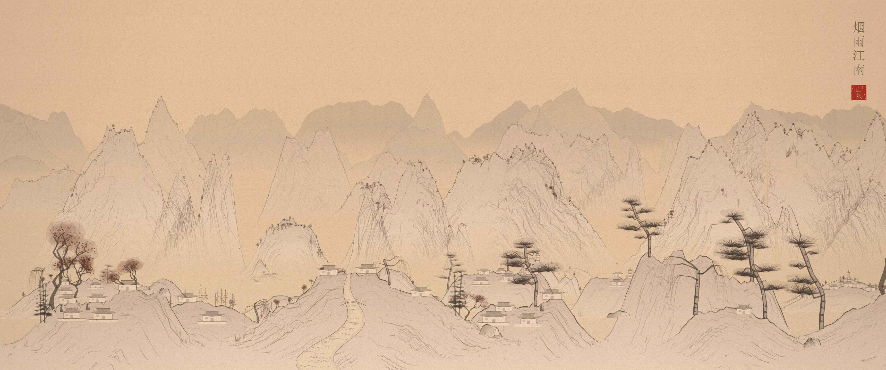
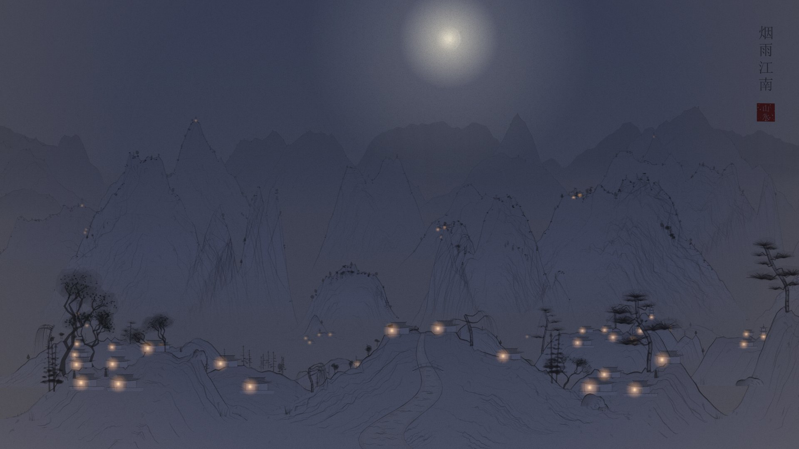
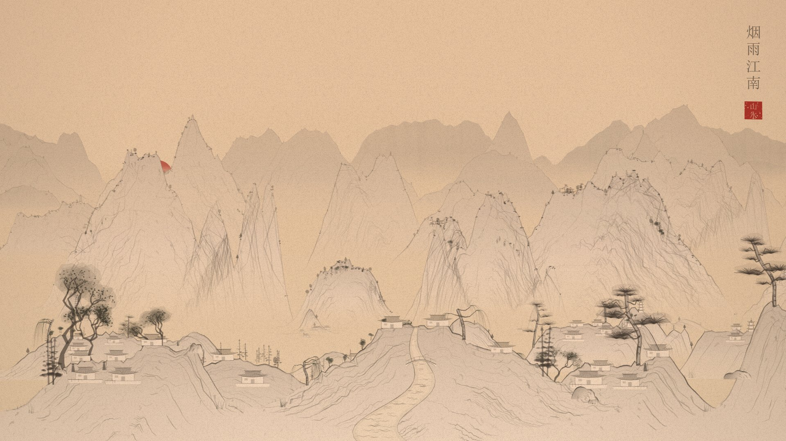

<div align="center">

# 山水 &nbsp;Shan Shui Infinite+

**An endless Chinese ink landscape that paints itself, live, behind your desktop icons.**

Mountains rise in mist, rivers wind past villages, lanterns flicker on at dusk, and it never repeats.

[](#-install)
[](#-every-screen)
[](#-light-as-a-brushstroke)
[](#-install)
[](LICENSE)



</div>

---

## ✦ What it is

A from-scratch reimagining of [LingDong-'s *shan-shui-inf*](https://github.com/LingDong-/shan-shui-inf), rebuilt to be a living
wallpaper. Every mountain, tree, roof tile and ripple is generated procedurally from a single number (a seed), drawn with
simulated brush strokes, and scrolled past you forever across **six layers of parallax depth**.

<table>
  <tr>
    <td width="50%"><br><sub><b>Autumn day</b>: maples, river villages, pagodas</sub></td>
    <td width="50%"><br><sub><b>Night</b>: real moon phase, lantern-lit valleys</sub></td>
  </tr>
  <tr>
    <td width="50%"><br><sub><b>Dusk</b>: follows your clock, minute by minute</sub></td>
    <td width="50%"><br><sub><b>Qīnglǜ style</b>: blue-green mineral pigments, spring blossom</sub></td>
  </tr>
</table>

## ✦ Features

| | |
|---|---|
| 🏔 **High-distance composition** | Six depth layers stacked the classical way (高远): far ranges fill the upper scroll and the inhabited valley sits below, so there's no empty sky |
| 🖌 **Real brushwork** | Pressure-tapered strokes. Hemp-fibre, axe-cut and Mi-dot texture strokes (皴), contour hatching, moss dots, ink washes |
| 🏘 **A lived-in world** | Villages with fences and paths, pagodas and pavilions, cliff temples, rivers with arched bridges, fishing boats, travellers |
| 🌲 **Forests and gardens** | Pines, firs, willows and broadleaf trees, alone or in dense groves |
| 🌫 **Atmosphere** | Seven drifting mist and cloud bands, waterfalls, birds in flight |
| 🕰 **Time and seasons** | Dawn → day → dusk → night follows your clock. The moon shows tonight's real phase. Spring blossom, summer green, autumn reds, bare winter. Auto rain and snow |
| 🀄 **Finishing touches** | A generated four-character inscription, a red seal stamp, paper grain and vignette |
| ♾ **Infinite and deterministic** | The same seed always paints the same scroll. Nothing is stored, so it can run for years |

## ✦ Install

Grab a build from [**Releases**](../../releases/latest):

| Your screen | Windows app | Lively Wallpaper / Wallpaper Engine |
|---|---|---|
| 1080p | `ShanShuiInfinite-1080p-Windows.zip` | `ShanShuiInfinite-1080p-Lively-WE.zip` |
| 1440p / 2K | `ShanShuiInfinite-2K-Windows.zip` | `ShanShuiInfinite-2K-Lively-WE.zip` |
| 2160p / 4K | `ShanShuiInfinite-4K-Windows.zip` | `ShanShuiInfinite-4K-Lively-WE.zip` |

**Windows app** (recommended, about 1.5 MB): unzip anywhere and run `ShanShuiWallpaper.exe`. A red 山 seal appears in the tray.
Right-click it for every setting, double-click it to pause, and choose **Options → Start with Windows** to keep it. **Exit** restores your normal wallpaper.
It needs the Edge WebView2 Runtime, which is preinstalled on Windows 11.

**Lively Wallpaper**: drag the `-Lively-WE.zip` onto Lively. **Wallpaper Engine**: unzip it into a folder and open `project.json` from the editor.

> The three builds are identical apart from their *Auto* resolution. Any build can switch resolution from its menu.

## ✦ Every screen

Resolution presets cap the render **height** (720p, 1080p, 1440p, 4K or native), and the width always follows your monitor.
21:9 and 32:9 ultrawides don't stretch anything; they simply see a wider stretch of the scroll. Multiple monitors each get their own scene.

## ✦ Light as a brushstroke

All the painting happens once, offscreen, in small chunks. Each frame just slides six pre-painted strips past each other at
sub-pixel precision. Measured on the real wallpaper at 1080p:

| | |
|---|---|
| Smooth 30 fps, 1.5× pace | **~10–20 % of one CPU core** (under 1 % of a 24-thread CPU; varies with what else is using the GPU) |
| JavaScript per frame | ~0.1–0.3 ms |
| Behind a maximized or fullscreen window | **Paused**, per monitor, ~1 % |
| On battery or energy saver | Frame rate capped (15 fps by default) |
| PC locked | Paused |

## ✦ Make it yours

Open **`web/config.js`**. No coding needed:

```js
baseSpeed: 21,        // scroll pace (14 = the original, slower pace)
pixelSnap: false,     // smooth sub-pixel motion; true = crisp whole-pixel steps
density: { mountains: 1, villages: 1, towers: 1, rivers: 1, trees: 1, boats: 1 },  // 0 = none, 2 = double
defaults: { fps: 30 },
```

Then choose **Reload wallpaper** in the tray menu. Everything else (speed, time of day, season, weather, style, resolution,
frame rate, birds, mist, inscription) is in the tray menu, or in Lively's and Wallpaper Engine's property panels.

**Browser preview:** serve the `web/` folder and open `index.html?preview=1`. Keys: <kbd>Space</kbd> pause · <kbd>N</kbd> new scene ·
<kbd>+</kbd>/<kbd>−</kbd> speed · <kbd>T</kbd> time · <kbd>S</kbd> season · <kbd>W</kbd> weather · <kbd>J</kbd> ink/blue-green · <kbd>Q</kbd> resolution · <kbd>H</kbd> stats.
URL parameters work too, for example `?seed=777&time=dusk&season=autumn`.

## ✦ How it works

The full tour, from seeds and chunks to brush polygons and the trick that gets a web page behind your desktop icons on
Windows 11 24H2+, is in **[docs/HOW-IT-WORKS.md](docs/HOW-IT-WORKS.md)**.

```
web/        the engine (shanshui.js), page, config.js, Lively + Wallpaper Engine metadata
host/       the Windows app (one C# file), build.ps1, package.ps1
docs/       how it works, screenshots
```

## ✦ Build from source

```bash
powershell -ExecutionPolicy Bypass -File host/package.ps1 -Version v1.0.0
```

This uses the C# compiler that ships with Windows (.NET Framework 4.8), so there is no SDK to install. It downloads the WebView2 SDK
(~9 MB, from nuget.org) once, and writes all six release zips to `release/`. Pushing a `v*` tag runs the same script on
GitHub Actions and attaches the zips to a Release automatically.

## ✦ Credits

Made by **Department of One**.

Inspired by **[shan-shui-inf](https://github.com/LingDong-/shan-shui-inf)** by Lingdong Huang (MIT). Its restraint (grey ink,
white-bodied mountains, volume built from many faint lines) is the north star for this project's look. This is an independent
rewrite and no code is shared. With a nod to the Song-dynasty masters whose scrolls lend the inscriptions their names:
*溪山清远*, *万壑松风*, *千里江山*.

MIT licensed. See [LICENSE](LICENSE).
