<div align="center">


# Paperwall

**Painted landscapes that drift past behind your desktop icons, live, without repeating.**

Pick one of five themes and a painting style. Mist rolls through the valleys, lanterns come on at dusk, and the scroll keeps going for as long as the PC is on.

[](#install)
[](#every-screen)
[](#light-on-your-pc)
[](#install)
[](LICENSE)

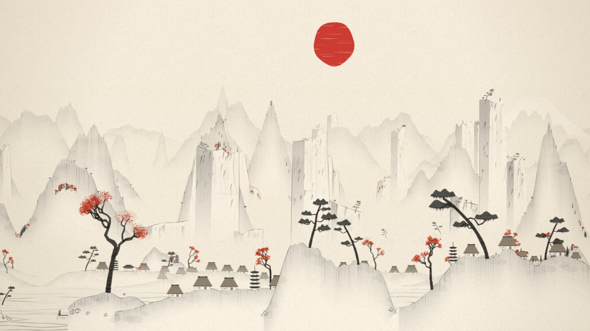

</div>

---

## Themes

Every mountain, tree, roof and wave is generated from a single number (the seed) and scrolled past you across five or six layers of parallax depth. The same seed always paints the same scroll, and nothing is stored, so it can run for years.

### Yūgen 幽玄 &nbsp;<sub>Japanese ink landscape</sub>

Leaning crags, Fuji on the horizon, thatched villages, pagodas and castles, torii standing in the water, sampans with a boatman, and cranes overhead. Blossom falls in spring and maple leaves in autumn. It comes in four styles:

<table>
  <tr>
    <td width="50%"><br><sub><b>Sumi-e 墨絵</b>: wet ink washes on white washi, a single red sun</sub></td>
    <td width="50%">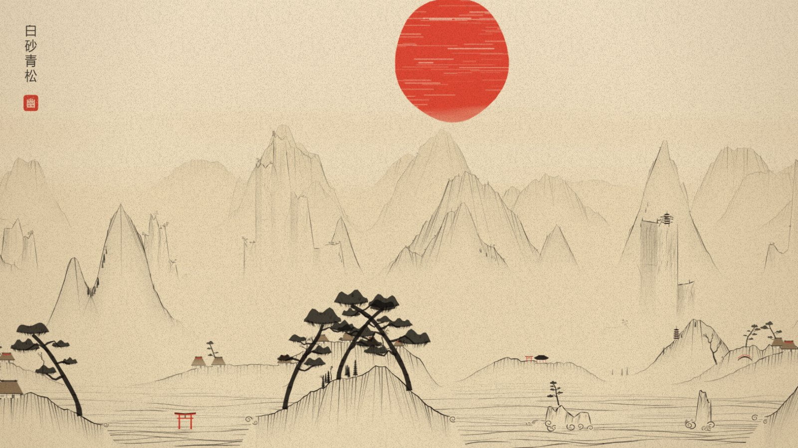<br><sub><b>Woodcut 版画</b>: dense black linework on sepia paper under a big red sun</sub></td>
  </tr>
  <tr>
    <td width="50%">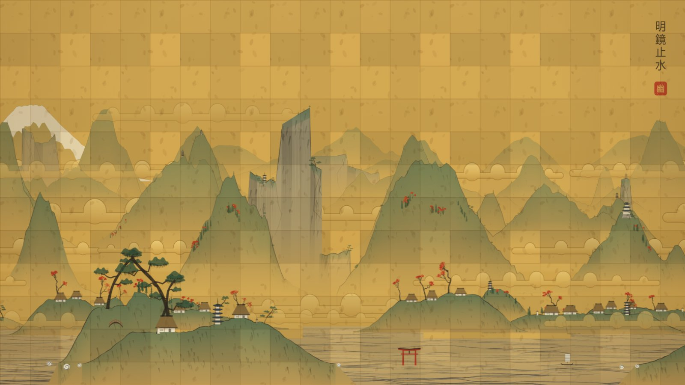<br><sub><b>Gold screen 金碧</b>: gold-leaf clouds, mineral greens and ink waves</sub></td>
    <td width="50%">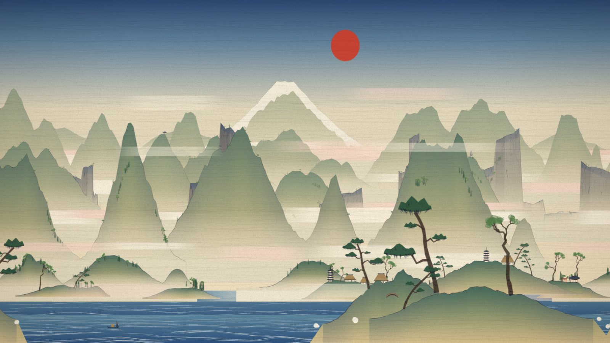<br><sub><b>Ukiyo-e 浮世絵</b>: Prussian-blue bokashi skies and flat woodblock colour</sub></td>
  </tr>
</table>

### Shan Shui 山水 &nbsp;<sub>Chinese ink landscape</sub>

A from-scratch reimagining of [LingDong-'s *shan-shui-inf*](https://github.com/LingDong-/shan-shui-inf): white-bodied mountains built from many faint brush lines, river villages with arched bridges, pavilions and cliff temples. Two styles, grey ink and blue-green qīnglǜ.

<table>
  <tr>
    <td width="50%">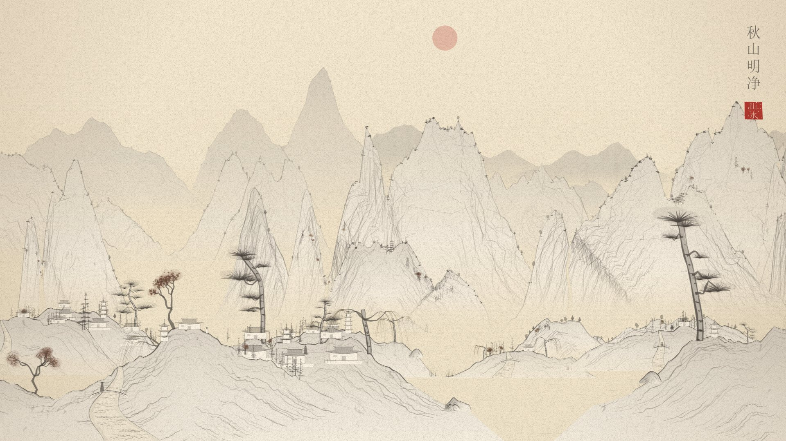<br><sub><b>Ink</b>: autumn maples, river villages, pagodas</sub></td>
    <td width="50%">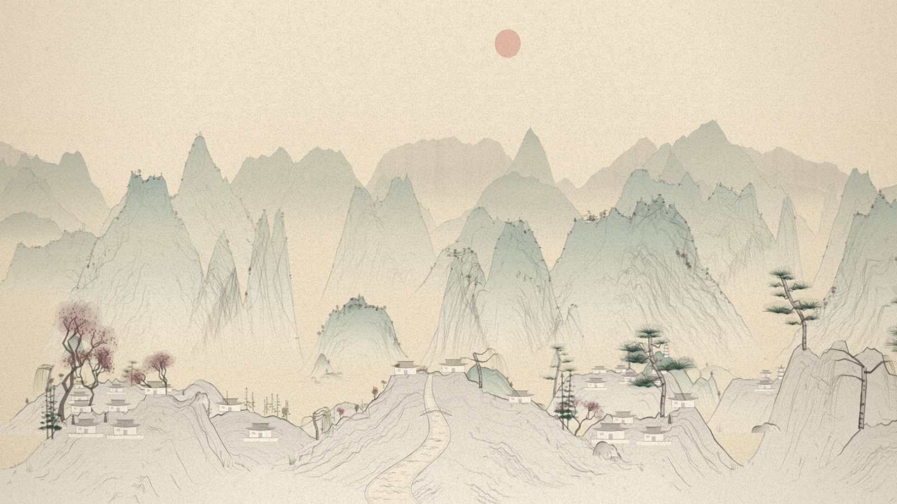<br><sub><b>Blue-green 青绿</b>: mineral pigments and spring blossom</sub></td>
  </tr>
</table>

### Jiangnan 江南 &nbsp;<sub>Chinese canal town</sub>

A closer view. White-walled houses with stepped gables and black tile roofs line a canal, stone arch bridges close into rings with their reflections, and wupeng boats go by under willows. Inspired by Wu Guanzhong's paintings of the water towns south of the Yangtze.

<table>
  <tr>
    <td width="50%">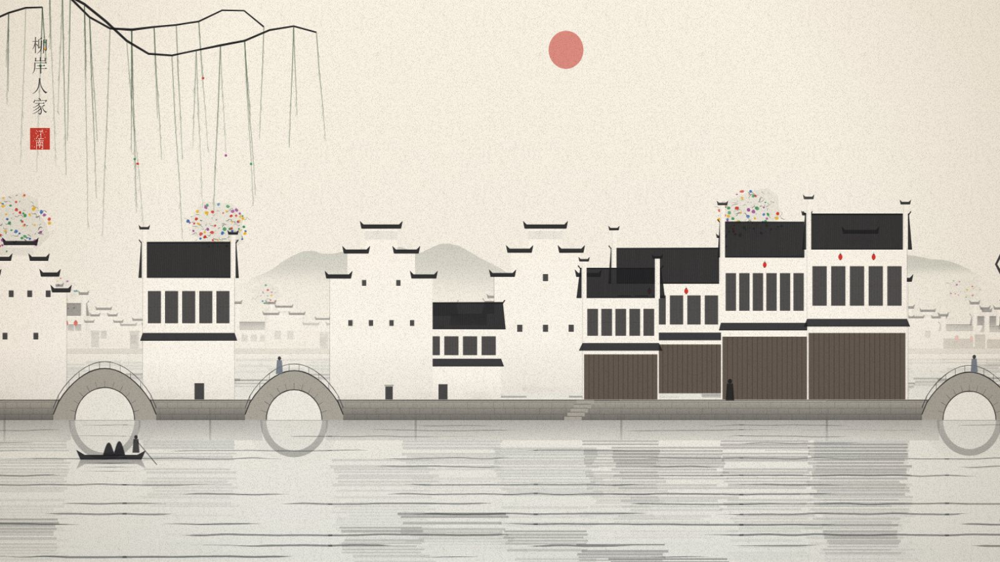<br><sub><b>Lines and dots 点线</b>: white walls, black roofs, wiry trees with dots of colour</sub></td>
    <td width="50%">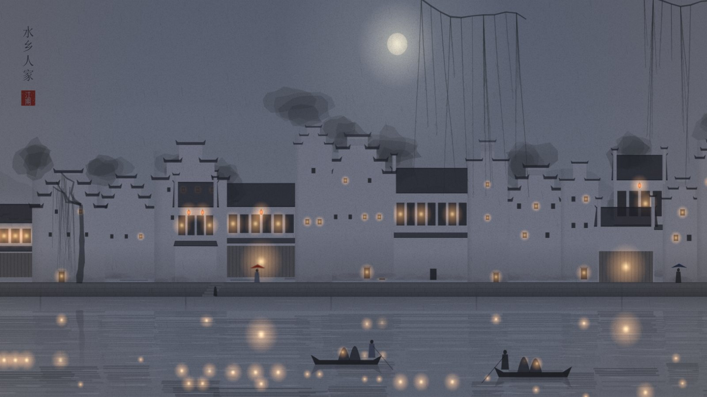<br><sub><b>Misty rain 烟雨</b>: grey wet ink, lamplight in the water</sub></td>
  </tr>
  <tr>
    <td width="50%">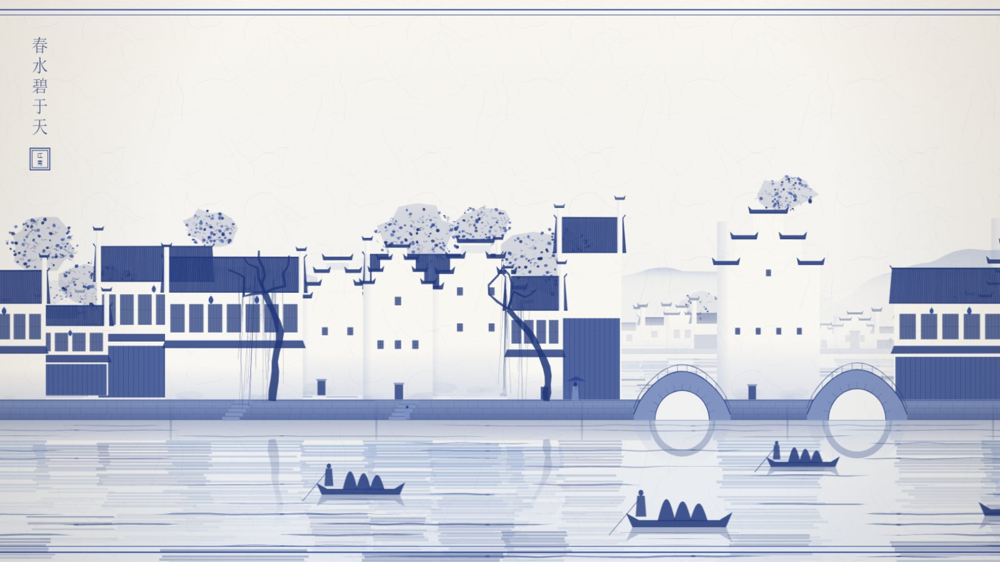<br><sub><b>Blue and white 青花</b>: cobalt on crackled porcelain glaze</sub></td>
    <td width="50%"></td>
  </tr>
</table>

### Tabiji 旅路 &nbsp;<sub>Japanese post road</sub>

The closest view: you walk along a village street on the old highway. Shopfronts with noren curtains, inns with lit paper screens, storehouses, a teahouse under a red parasol, shrine gates and roadside pines, with travellers, packhorses and palanquins on the road. Inspired by Hiroshige's Tōkaidō prints and Kawase Hasui's night scenes.

<table>
  <tr>
    <td width="50%">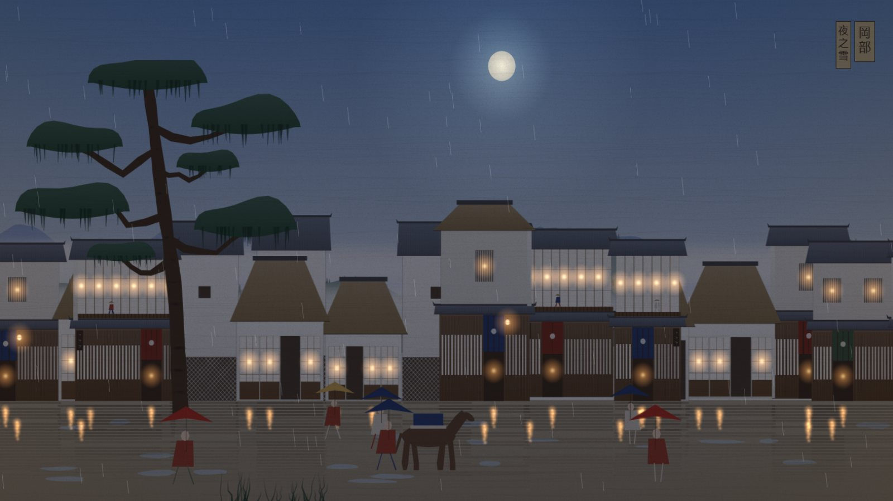<br><sub><b>Shin-hanga 新版画</b>: soft graded colour and lamplight on a wet road</sub></td>
    <td width="50%">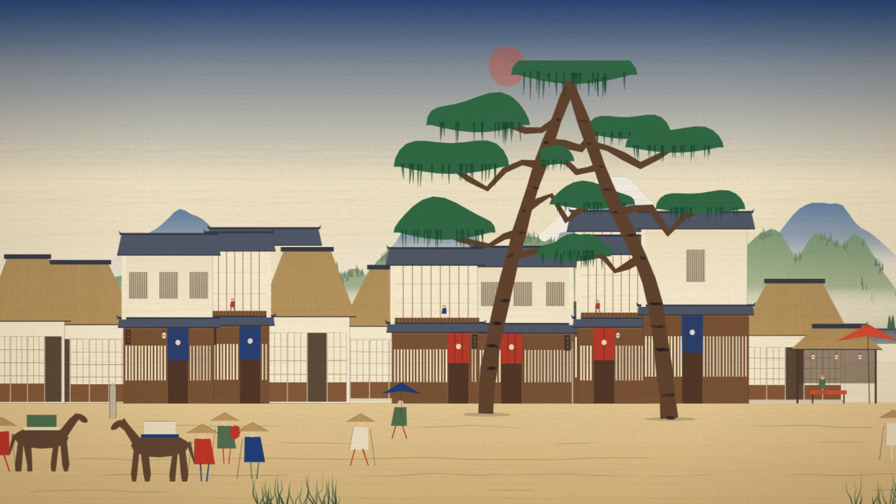<br><sub><b>Hiroshige 広重</b>: flat colour, a Prussian-blue sky and crisp keylines</sub></td>
  </tr>
  <tr>
    <td width="50%">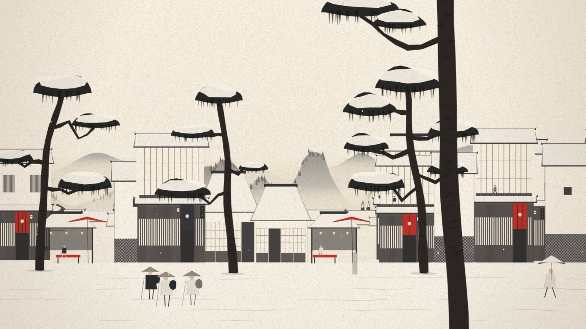<br><sub><b>Sumi 墨</b>: ink only, with red for gates and lanterns</sub></td>
    <td width="50%">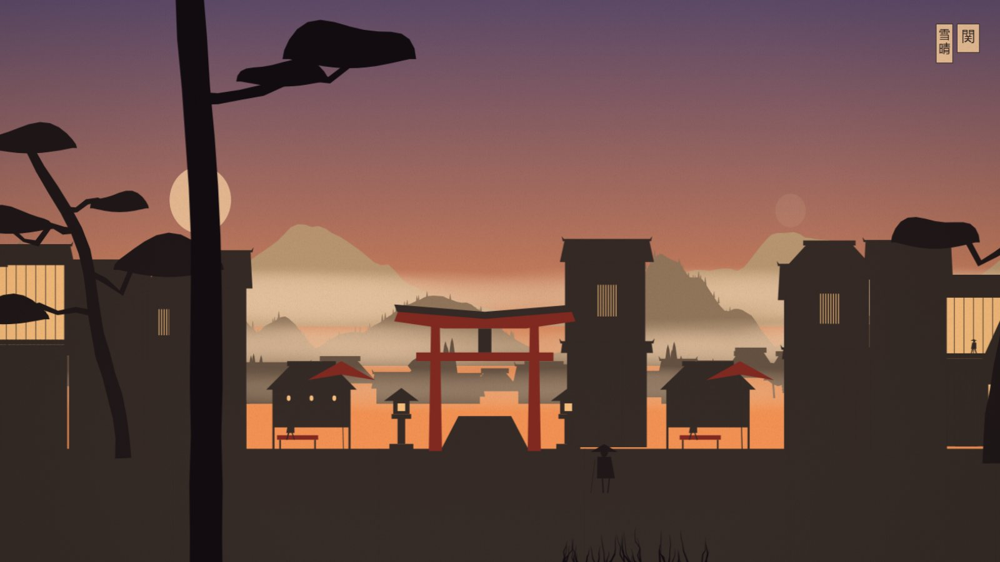<br><sub><b>Cut paper 切り絵</b>: layered silhouettes with glowing cut-out windows</sub></td>
  </tr>
</table>

### Sprawl &nbsp;<sub>Cyberpunk city</sub>

The one theme with no paper in it. A rain-soaked street at night: shophouses stacked with air conditioners and fire escapes, vertical neon signs, wires strung across the road, people under glowing umbrellas, and flying cars crossing between the towers. An elevated train runs past now and then. The signs use pictograms only, so no text appears anywhere.

<table>
  <tr>
    <td width="50%">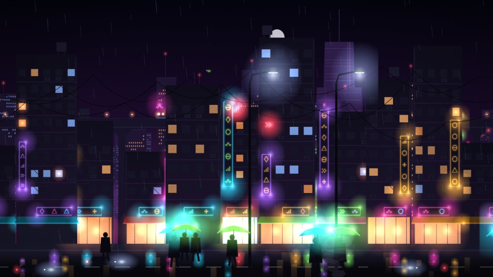<br><sub><b>Neon noir</b>: wet street level, neon reflected in the road</sub></td>
    <td width="50%">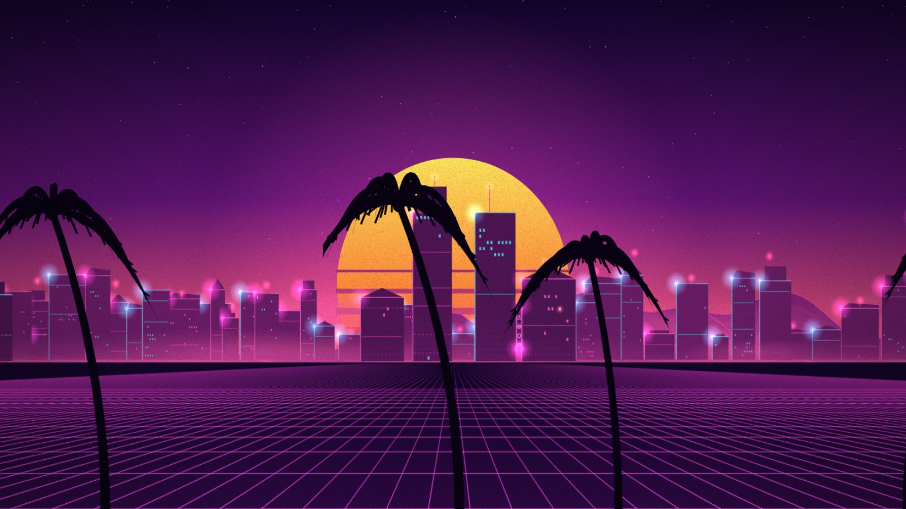<br><sub><b>Synthwave</b>: a skyline on a glowing grid under a striped sun, palms in front</sub></td>
  </tr>
  <tr>
    <td width="50%">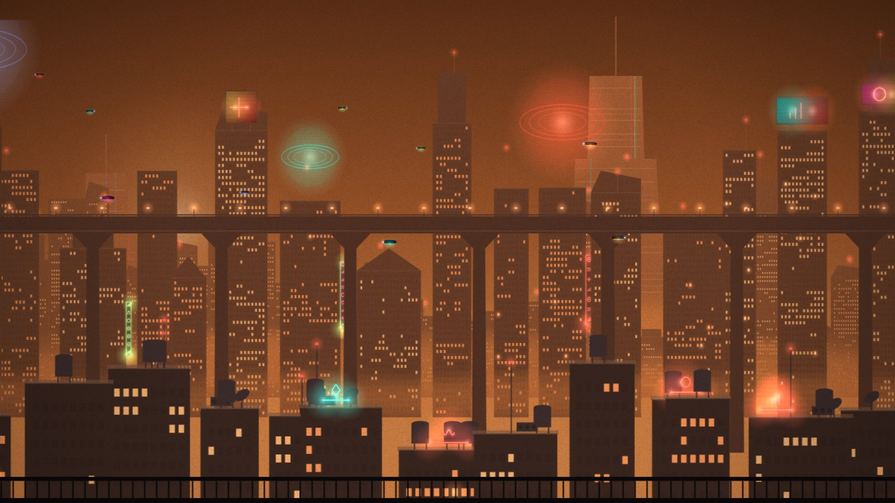<br><sub><b>Amber smog</b>: the view from the rooftops, with the train on its viaduct and holograms in the haze</sub></td>
    <td width="50%">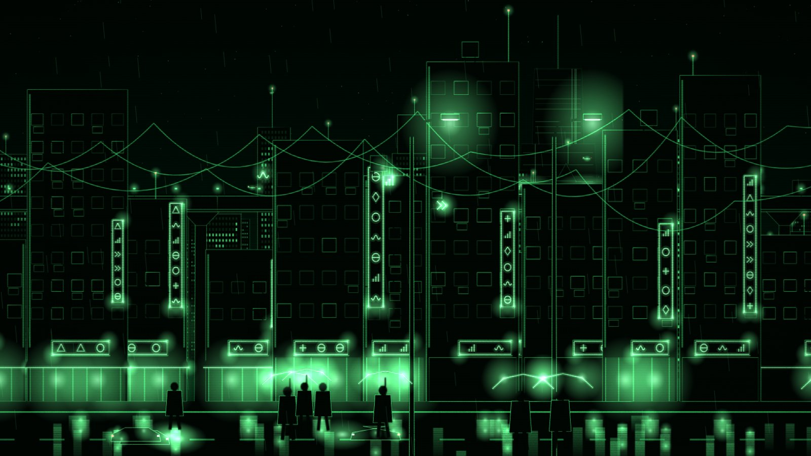<br><sub><b>Phosphor</b>: green wireframe on black, like an old terminal</sub></td>
  </tr>
</table>

Each theme is a single file in `web/themes/`, and the app picks it up on its own.

## Features

| | |
|---|---|
| 🕰 **Time and seasons** | Dawn, day, dusk and night follow your clock. The moon shows tonight's real phase. Seasons follow the calendar, with automatic rain, snow and falling blossom |
| 🖌 **Brushwork** | Pressure-tapered strokes, texture strokes, ink washes and paper grain, drawn differently for each style |
| 🌫 **Atmosphere** | Drifting mist and cloud bands, waterfalls, birds and cranes in flight, lit windows at night |
| 🎛 **Settings two ways** | A Paperwall window with live previews of every theme and style, and the full set of options in the tray menu |

## Install

Grab a build from [**Releases**](../../releases/latest). There is one download for every screen size:

| Windows app | Lively Wallpaper / Wallpaper Engine |
|---|---|
| `Paperwall-Windows.zip` | `Paperwall-Lively-WE.zip` |

**Windows app** (recommended, about 1.5 MB): unzip anywhere and run `Paperwall.exe`. The Paperwall icon appears in the tray.
Double-click it to open the Paperwall window, or right-click it for the same settings as a menu. Turn on **Start with Windows** to keep it. **Exit** restores your normal wallpaper.
It needs the Edge WebView2 Runtime, which comes with Windows 11.

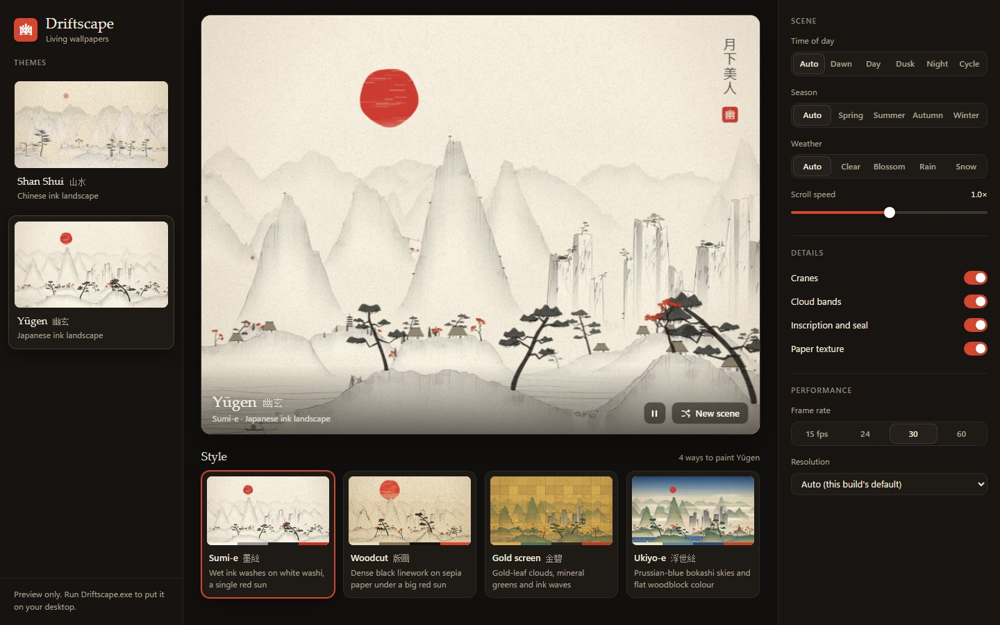

**Lively Wallpaper**: drag the `-Lively-WE.zip` onto Lively. **Wallpaper Engine**: unzip it into a folder and open `project.json` from the editor. Both offer a **Look** list with every theme and style.

> Resolution *Auto* matches your monitor, up to 4K. If your PC struggles, pick 1080p or 720p in the settings.

## Every screen

*Auto* renders at your monitor's own height, up to 4K. The other presets cap the render **height** (720p, 1080p, 1440p, 4K or native), and the width always follows your monitor.
21:9 and 32:9 ultrawides see a wider stretch of the scroll with nothing stretched. Multiple monitors each get their own scene.

## Light on your PC

All the painting happens once, offscreen, in small chunks. Each frame slides six pre-painted strips past each other at sub-pixel precision. Measured on the real wallpaper at 1080p:

| | |
|---|---|
| Smooth 30 fps | **about 10 to 20% of one CPU core** (under 1% of a 24-thread CPU) |
| JavaScript per frame | 0.1 to 0.3 ms, for every theme |
| Another app in front for 1.5 seconds | **Paused** until you come back to the desktop (can be turned off) |
| Behind a maximized or fullscreen window | Paused, per monitor |
| On battery or energy saver | Frame rate capped (15 fps by default) |
| PC locked | Paused |

## Make it yours

Open **`web/config.js`**. No coding needed:

```js
baseSpeed: 21,        // scroll pace (14 = the original, slower pace)
pixelSnap: false,     // smooth sub-pixel motion; true = crisp whole-pixel steps
density: { mountains: 1, villages: 1, towers: 1, rivers: 1, trees: 1, boats: 1 },  // 0 = none, 2 = double
defaults: { theme: 'yugen', fps: 30 },
```

Then choose **Reload wallpaper** in the tray menu.

**Browser preview:** serve the `web/` folder and open `gallery.html` for the settings window, or `index.html?preview=1` for the bare wallpaper. Keys: <kbd>Space</kbd> pause · <kbd>N</kbd> new scene ·
<kbd>V</kbd> theme · <kbd>J</kbd> style · <kbd>+</kbd>/<kbd>-</kbd> speed · <kbd>T</kbd> time · <kbd>S</kbd> season · <kbd>W</kbd> weather · <kbd>Q</kbd> resolution · <kbd>H</kbd> stats.
URL parameters work too, for example `?theme=yugen&style=hanga&seed=777&time=dusk`.

## How it works

The full tour, from seeds and chunks to brush polygons and the trick that gets a web page behind your desktop icons on
Windows 11 24H2+, is in **[docs/HOW-IT-WORKS.md](docs/HOW-IT-WORKS.md)**.

```
web/core.js       the shared engine: chunks, parallax strips, mist, sky, lights, weather
web/themes/       one file per theme (shanshui.js, yugen.js, jiangnan.js, tabiji.js, sprawl.js)
web/stage.js      runs the chosen theme and crossfades between themes
web/index.html    the wallpaper page; gallery.html is the settings window
host/             the Windows app (one C# file), build.ps1, package.ps1
```

Adding a theme means subclassing the engine with a scene recipe and painters, then calling `Paperwall.register(...)`. The tray menu and the Paperwall window list it automatically.

## Build from source

```bash
powershell -ExecutionPolicy Bypass -File host/package.ps1 -Version v2.0.0
```

This uses the C# compiler that ships with Windows (.NET Framework 4.8), so there is no SDK to install. It downloads the WebView2 SDK
(about 9 MB, from nuget.org) once, and writes both release zips to `release/`. Pushing a `v*` tag runs the same script on
GitHub Actions and attaches the zips to a Release.

## Credits

Made by **Department of One**. The name is a joke on *wallpaper*: every scene is painted on paper.

Shan Shui is inspired by **[shan-shui-inf](https://github.com/LingDong-/shan-shui-inf)** by Lingdong Huang (MIT). Its restraint (grey ink,
white-bodied mountains, volume built from many faint lines) set the look for that theme. This is an independent
rewrite and no code is shared. Yūgen draws on Kano-school gold screens, Sesshū's ink landscapes and Edo woodblock prints. Jiangnan follows Wu Guanzhong's water towns, and Tabiji follows Hiroshige's Tōkaidō series and Kawase Hasui's shin-hanga. Sprawl borrows from the neon cities of eighties and nineties science fiction.

MIT licensed. See [LICENSE](LICENSE).
