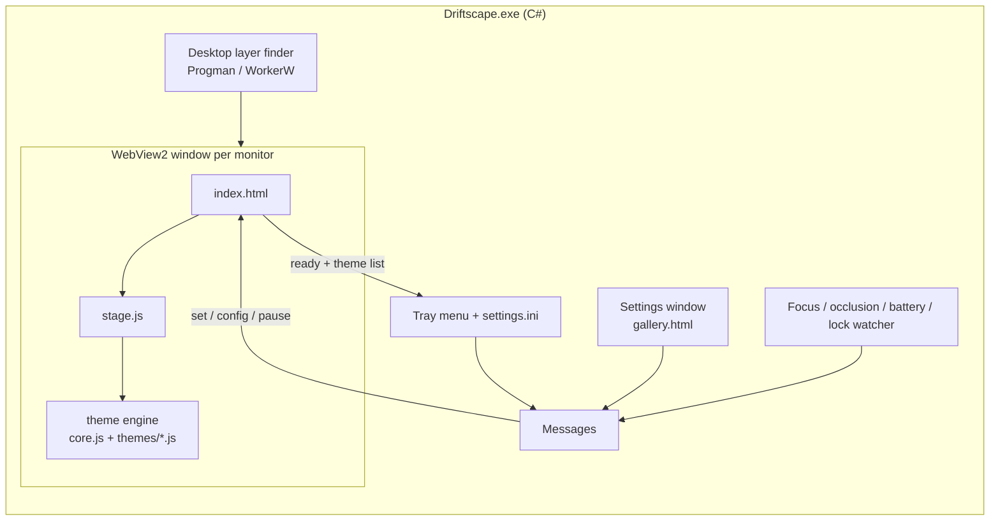
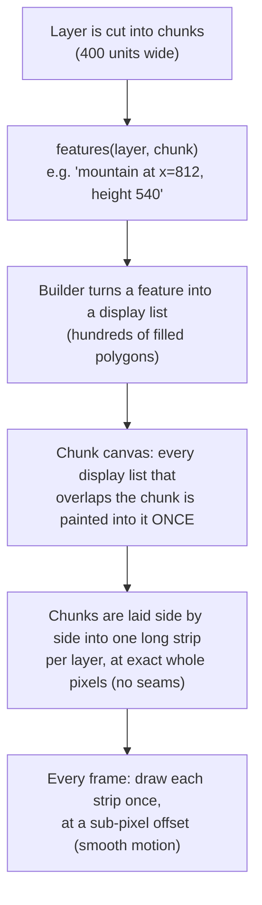

# How Driftscape works

This is a tour of how the landscapes are generated and drawn, and how they end up behind your desktop icons.
The examples come from the Shan Shui theme; Yūgen uses the same machinery with its own scene recipe and painters.

| Part | File | Job |
|---|---|---|
| **Engine** | `web/core.js` | The shared machinery: chunks, parallax strips, mist, sky, night lights, weather |
| **Themes** | `web/themes/*.js` | Each one subclasses the engine and supplies the scene recipe and painters |
| **Stage** | `web/stage.js` | Runs the chosen theme and crossfades when you switch |
| **Pages** | `web/index.html`, `web/gallery.html` | The wallpaper itself, and the settings window with live previews |
| **Host** | `host/Driftscape.cs` | A small Windows app. It puts the page behind your icons, adds the tray menu and the settings window, and pauses when you can't see it |



The page sends the host its list of themes and styles when it loads, and the tray menu is built from that list, so a new
theme file needs no change to the Windows app.

---

## 1. Coordinates: everything is "1000 units tall"

The engine never thinks in pixels. The screen is always **1000 units tall**, and the width is however many units fit
(1778 on 16:9, 2370 on 21:9, 3556 on 32:9). Units are converted to pixels only at the very last moment, when a
piece of the scene is rasterised. That's why:

- The same scene looks identical at 1080p, 1440p and 4K. Only the sharpness changes.
- Ultrawide monitors simply see *more* of the scroll, never a stretched version.
- Resizing never regenerates the scene. It only re-paints the cached pieces at the new resolution.

## 2. Seeds: the same number always gives the same painting

A **seed** (just an integer) decides everything. Nothing in the scene uses `Math.random()`. Instead, every
decision is derived from a hash of *where* it is:

```
rng = RNG( hash(seed, layer, chunkIndex, featureIndex) )
```

So the mountain at chunk #812 of the main layer is always the same mountain for a given seed, however you got there.
That makes the scroll truly infinite (nothing has to be stored), and lets any piece be thrown away and rebuilt identically later.
Two kinds of randomness are used:

- **RNG**: a fast pseudo-random sequence (`mulberry32`-style), used for "pick a size, pick a position".
- **Value noise / fBm**: smooth wiggly curves, used for ridge lines, trunk bends and the large-scale "scenery mood"
  (`macro()`), which decides whether a stretch of the scroll is dramatic peaks or open lake.

## 3. Layers, parallax and "high distance"

The painting is a stack of six **depth layers**, drawn back to front. Each scrolls at its own speed (`par`), which creates
depth as the camera drifts right. The composition follows the classical **high-distance (高远)** convention: the farther a
layer is, the *higher* its baseline sits on the scroll. Distant ranges fill the upper half instead of all resting on one horizon.
Distant layers are pale and thin-lined, near layers dark and bold, which is the ink-painting version of atmospheric perspective.

| # | Layer | Baseline (of 1000) | Scroll speed | What lives there |
|---|---|---|---|---|
| 0 | `distant` | 440 | 4 % | Flat grey wash ranges with soft vertical bleeding, no linework |
| 1 | `far` | 520 | 10 % | Pale massifs and spires, rice-dot or hemp texture, a few tiny pagodas |
| 2 | `mid` | 625 | 22 % | Mountains with ridge trees, groves, mountain hamlets, temples |
| 3 | `main` | 745 | 42 % | The big peaks: waterfalls, cliff temples, forest groves, foothills with villages |
| 4 | `valley` | 835 | 66 % | The inhabited middle distance: wooded hills, village plateaus, rivers and bridges, sails |
| 5 | `near` | 905 | 100 % | Foreground shores: big pines and willows, villages, rivers, boats |

Between layers, seven **mist bands** slide by at their own speeds. The low ones veil each layer's foot, and the high,
thin ones are clouds drifting across the peaks. See the `LAYERS` and `MIST` tables at the top of `themes/shanshui.js`.

## 4. Chunks, features and display lists: the core trick



1. **Features.** For each chunk, `_gen()` decides *what* lives there: a few mountains, a bank with trees, a boat, some ripples.
   Each feature is a tiny record (`kind`, `x`, size parameters, its own seed). This is cheap.
2. **Display lists.** The first time a feature is needed, its builder (`B.main`, `B.bank`, `B.boat`, …) expands it into a
   **display list**: a flat list of polygons with fill colours or gradients, plus "clip to this shape" groups and night-light
   positions. This is the expensive "painting" step (about 1–9 ms). The result is cached on the feature.
3. **Chunk bitmaps.** A chunk is rasterised once into its own small canvas. Mountains are wider than a chunk, so each chunk
   also draws the overlapping features from its neighbours (±2 chunks), clipped to its own edges. Features are sorted by a fixed
   depth key, so the overlap order is identical in every chunk and there are no seams.
4. **Strips.** Each layer keeps one long bitmap, about a screen wide plus one chunk, holding its chunks side by side at
   exact whole-pixel positions. When the camera passes a chunk boundary, the strip slides left by one chunk and the next
   chunk is pasted in. A test confirms a frame reached by scrolling is pixel-identical to one rebuilt from scratch.
5. **Frames.** Per frame the engine draws each layer's strip **once**, at a fractional (sub-pixel) offset, so every layer
   glides smoothly instead of stepping a whole pixel at a time. Because a strip is one image, the sub-pixel placement can't
   open seams between chunks. Mist bands are repeating patterns, smooth and seamless in the same way. About 0.25 ms of JavaScript per frame.
6. **Recycling.** Chunk bitmaps are only a staging area now. Each is recycled as soon as it's pasted into the strip, and
   features that scroll off the left are forgotten. The next chunk to the right is painted ahead of time in idle moments
   (`_prefetch`), so scrolling never stutters.

## 5. How a brush stroke is made

Canvas lines are uniform and mechanical, so the engine doesn't use them. Every mark is a **filled polygon** built by `brush()`:

1. Take a centre line (a list of points), usually from `curve()`, which bends and wiggles a straight line with noise.
2. At each point, compute the sideways direction (the normal) and a width. The width follows a pressure profile:
   thin at the tip, full in the middle, tapering out, with a little random wobble for bristle texture.
3. Walk down the left edge and back up the right edge. The result is one closed polygon that looks like a brush mark.

Everything (outlines, texture strokes, pine needles, roof tiles, ripples) is made of these.

## 6. How a mountain is painted (`mtnBody`)

1. **Ridge line.** Up to six Gaussian-like "bumps" are combined with `max()` (each bump is one peak). Then come a skew,
   an optional flat top (mesa), fBm noise for irregularity and fine jitter. A window function pins both ends to the baseline.
   The *form* (spire, massif or dome) just changes how many bumps there are and how wide and sharp they are.
2. **Silhouette fill** in paper colour. This hides whatever is behind, the way opaque ink-wash mountains do.
3. **Inside a clip of the silhouette:**
   - *Wash*: a vertical gradient of diluted ink, darkest at the summit (or blue-green in the *qinglu* style).
   - *Contour hatching*: broken lines that echo the ridge at increasing depths, giving folds and strata.
   - *Texture strokes (cun 皴)*: **hemp-fibre** (long thin strokes down the slope), **axe-cut** (short, broad, heavy-headed wedges)
     or **Mi dots** (soft horizontal blobs for misty distant hills).
   - *Spines*: strokes running down from each summit, with hatching on their shadow side.
   - *Waterfall*: sometimes, a paper-white ribbon falls from the valley between two peaks.
   - *Base mist*: a gradient to paper colour, so the foot of the mountain dissolves.
4. **Outline**: the ridge is inked in short overlapping segments of varying weight, fading out toward the base.
5. **Extras**: moss dots on the ridges, rows of tiny trees, pine groves, temples and pavilions on flat shoulders, and foothills in front.

## 7. Everything else

| Element | Recipe |
|---|---|
| **Pine** | Leaning noisy trunk (paper fill, ink wash, two edge strokes, bark scales), alternating branches, fan-shaped needle clusters |
| **Leafy tree** | Recursive branching (3–4 levels). Leaf clusters of dots or 介-shaped strokes in seasonal colour, or bare in winter |
| **Willow** | Short thick trunk with long drooping strands (quadratic curves) |
| **Buildings** | Wall rectangle plus an upturned-eave roof polygon, tile lines and a ridge beam. Pavilions use posts, pagodas stack 3–6 tiers. Windows record a *light* for night |
| **Banks / shores** | Flat-topped land with asymmetric slopes, strata lines, axe texture, grass ticks, rocks, reeds, trees, houses and people |
| **Water** | Short, faint horizontal brush strokes, longer and denser toward the viewer |
| **Boats** | Hull, optional arched canopy (with a lantern), a fisherman with a pole, ripples. Placed only where no bank is |
| **Rivers** | A meandering ribbon that emerges from behind the land's skyline and widens toward the viewer, with inked banks, soft bank shadows and wave-mark ripples. Houses and trees steer around it, and land carrying a river is drawn in front of its neighbours |
| **Bridges** | Arched deck with an opening underneath and a railing, sometimes with a traveller crossing |
| **Villages** | A back row of houses along the ridge and a front row lower on the bank face, plus fences, a path, trees, villagers and often a pagoda rising behind the roofs |
| **Forest groves** | Dense clumps of firs and round-crowned trees. Back rows sit higher and smaller, so a grove has depth |

## 7½. The look, and why it's restrained

Studying Lingdong's original showed that its calm comes from what it *doesn't* do. Its SVG contains about 41,000 marks, and
every one is grey `rgba(100,100,100, 0.1–0.7)`: no black anywhere. Mountain bodies are filled with white, so they glow
slightly brighter than the paper. This project follows the same rules:

- **Grey ink, never black.** `INK` is a warm grey and each layer's ink strength is below 1, so the darkest mark lands around
  50 % grey. Distance is shown by lighter ink, not smaller shapes alone.
- **White-bodied mountains** fade to paper at the foot through the mist gradient.
- **Volume from line density, not dark fills.** Each mountain is imagined as 10 nested, shrinking copies of its silhouette.
  A few hundred faint, short arcs ride *between* those rings, only on the left and right thirds, so the flanks shade and the
  centre stays lit. Outer rings wander more than inner ones.
- **Doubled pencil lines.** Outlines are thin, with a second, fainter pass slightly inside, the searching line of a sketch.
- **Trees as many soft dabs.** Conifers are tiers of small grey dabs on a thin trunk, never solid black silhouettes.
  Seasonal colour is a hint (`color: 0.35`), not paint.
- **Order on the ground.** Houses, towers and tree trunks reserve horizontal space in an occupancy map, so nothing is
  generated on top of anything else. The front row of a village sits on small terraces cut into the slope.

## 8. One frame, in order

1. Sky gradient, then the sun (a red seal-like disc) or the moon, drawn with its **real phase** for today's date.
2. For each layer: blit its chunks, then any mist bands that belong after it.
3. Birds: flocks of flapping V-strokes, drawn live.
4. Inscription (a four-character phrase picked by the seed) and the red seal.
5. **Overlay, multiplied over everything**: the time-of-day tint, a moon glow, paper grain and a vignette.
   It is prebuilt into one bitmap and only rebuilt when the light changes.
6. Night lights, then rain or snow. Lights are depth-correct at two levels:
   - **Within a layer**, each chunk bakes a *light map* in the same painter's order as its colour. A lantern is added when its
     house is painted, and everything painted afterwards (a nearer bank, a hill in front) erases the light behind its shape.
   - **Between layers**, the per-layer light strips are combined back to front in a half-resolution buffer. Each nearer layer's
     strip erases the light behind its hills, and each mist band dims it. The result is *added* onto the night-tinted frame,
     with a slow, small breathing per layer.

   So a lantern is only ever visible where its window is.

## 9. Time, seasons and weather

- **Time of day** interpolates a keyframe table (`TOD`) of tint colours by your clock. 06:30 is rosy dawn, 18:00 golden,
  21:00 night blue. Night strength controls the moon, the lights and the birds (birds go to roost).
- **Season** follows the month and only changes colours and foliage: spring blossom, summer green, autumn red, winter bare.
- **Weather** in auto mode is decided once per day from `hash(seed, day)`: snow is likely in winter, occasional rain otherwise.

## 9½. Motion design

The motion follows the principles Emil Kowalski teaches for interfaces: motion should be purposeful, eased, never abrupt, and
should respect the user's settings.

| Moment | Behaviour |
|---|---|
| Startup / resume after pause | Scroll speed eases in over ~1.2 s (ease-out cubic) instead of lurching to full speed |
| New scene | The old painting dissolves over the new one over 1.6 s, with an ease-out curve |
| First paint | The canvas fades in with a strong ease-out (`cubic-bezier(0.23, 1, 0.32, 1)`) |
| Time of day | Keyframes are blended with smoothstep, so dawn and dusk drift rather than step |
| Lanterns | Fade in with nightfall, then breathe slowly by a few percent. A candle, not a strobe |
| Parallax | Sub-pixel, at a steady cadence, so nothing judders |
| Windows "Animation effects" off | `prefers-reduced-motion` is honoured: a third of the speed, with no birds, rain or snow |

## 10. Why it's light

- **Paint once, blit forever.** All the expensive work happens once per chunk (section 4), and a frame is just six strip draws.
- **Sleep between frames.** The loop sleeps on a timer until the next frame is due, then asks for exactly *one*
  `requestAnimationFrame`. Keeping animation frames permanently requested makes the browser run its whole frame pipeline on
  every vsync, 144 times a second on a 144 Hz monitor, even when nothing is drawn. Fixing this alone cut CPU use by about 80 %.
- **Frame cap.** It renders at the fps cap (30 by default) while scrolling. With `pixelSnap: true` in `config.js` it only redraws
  when the nearest layer crosses a whole pixel, which is crisper and even lighter but steps visibly.
- **Resolution budget.** The quality preset caps the internal canvas height (1080p, 1440p, 4K or native). The browser upscales smoothly.
- **The host pauses it** per monitor when a window is maximized or fullscreen, and when the PC is locked. It caps the fps on battery
  or energy saver, and tells WebView2 to trim memory while paused.

## 11. How the host gets behind your icons

Windows draws the desktop as a window called **Progman**. Inside it, `SHELLDLL_DefView` holds the icons, and a **WorkerW**
holds the static wallpaper.

1. The host sends Progman the undocumented message `0x052C`, which makes Explorer split the wallpaper into its own WorkerW layer.
   Lively, Wallpaper Engine and others use the same message.
2. **Windows 11 24H2+**: the icons and the WorkerW are both *children* of Progman. The host makes its window a child of Progman too,
   placed in z-order *between* the icons and the static wallpaper. It is marked as a layered window, which this compositor requires.
3. **Older Windows**: the WorkerW is a separate top-level window, and the host simply becomes its child.
4. One window per monitor, positioned in the parent's coordinates. If Explorer restarts (the `TaskbarCreated` broadcast) or the
   displays change, everything is rebuilt.

The host talks to the page with WebView2 messages such as `{"type":"set","key":"season","value":"winter"}` or
`{"type":"pause","value":true}`, and switches theme and style together with `{"type":"config","value":{"theme":"yugen","style":"hanga"}}`.
Lively and Wallpaper Engine reach the same `stage.set()` through their own callbacks.

The host also checks which window is in front every half second. If another app has been in front for 1.5 seconds, the
wallpaper pauses until the desktop, the taskbar or the Driftscape window is back in front. In a browser, `stage.autoPause()`
does the same with the page's focus and visibility events.

## 12. Where to tweak

**Without touching code**, edit `web/config.js`: scroll speed, smooth vs. pixel-snapped motion, default frame rate, and
density multipliers for mountains, villages, towers, rivers, trees and boats. In the Windows app, choose **Reload wallpaper** from the tray menu
afterwards. In code (each theme file has its own copy of these tables):

| Want to change… | Look at |
|---|---|
| How many layers there are, their heights and baselines, scroll speeds | `LAYERS` |
| Mist band heights and density | `MIST` |
| What appears where (mountain counts, villages, boats) | `Engine._gen()` |
| How a specific thing is drawn | `B.*` builders and painter functions (`pine`, `house`, `mtnBody`, …) |
| Colours by time of day | `TOD` |
| Seasonal colours | `SEASONS` |
| Inscription phrases | `PHRASES` |
| Resolution presets | `QUALITY` in `core.js` |
